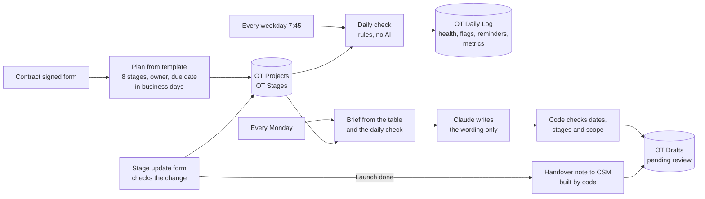

# Onboarding Tracker: B2B implementation plans, risk flags and checked AI drafts in n8n

A portfolio project on fictional data. When a contract is signed, the workflow builds an 8-stage onboarding plan from a rules template, checks every project each working day, flags the ones that are slipping and drafts client emails that a person reviews before anything is sent.

**Built and tested, not deployed.** It has not been used with a real client.

## Problem

In B2B SaaS, the time between "contract signed" and "client sees value" is where many accounts are won or lost. Implementations stall quietly: the client has not sent API keys, a stage has had no update for a week, or the launch date promised in sales can no longer be met. Spreadsheets show what is planned, not what is late, and status emails often repeat old dates.

## How it works

| Workflow | What it does |
| --- | --- |
| `OT Contract Signed` | Form: client, plan, technical contact, integrations, target launch. Builds the plan from the template and saves it. |
| `OT Stage Update` | Form: project, stage, status, date, note. Rejects a stage closed while an earlier one is open, a block without a note and a future date. Closing Launch creates the handover note. |
| `OT Daily Check` | Reminders, risk flags, health colour and metrics for every project. A `Simulated today` field replays any date. |
| `OT Drafts` | Kickoff email or weekly status in English. Claude writes, code checks, a person approves. |
| `OT Eval`, `OT Draft Eval` | Run the workflows above in test mode on 6 fictional projects. |

### The plan template

| # | Stage | Owner | Business days |
| --- | --- | --- | --- |
| 1 | Kickoff | us | 2 |
| 2 | Technical access | client | 3 (+1 with SSO) |
| 3 | Integration installed | client (us for CSV-only) | 2 + API 4, SSO 3, webhook 2, CSV 1 |
| 4 | First test event (First test import for CSV-only) | us | 2 |
| 5 | First value | client | 3 |
| 6 | Training | us | 2 |
| 7 | Launch | us | 1 |
| 8 | Handover to CSM | us | 2 |

If the template plan ends after the target launch from the contract, the plan is saved with a warning on day one.

### Daily rules

All thresholds sit in one `RULES` block at the top of the code.

| Rule | Result |
| --- | --- |
| Current stage past its due date | Reminder to its owner: our implementation lead or the client's technical contact |
| No status change for **more than 5** business days | `stalled` flag |
| Client marks a stage as blocked (note required) | `blocked by client` flag and reminder |
| Projected launch later than the target | `launch at risk` flag |
| Health | **red**: stalled, launch at risk or more than 5 business days late. **yellow**: late or blocked. **green**: otherwise |

When a stage finishes late, the next stage still gets its normal number of days from that point. Without this, one delay would mark every later stage as overdue on its first day.

## Metrics

| Metric | Definition |
| --- | --- |
| Time to first value | Calendar days from contract signature to the day the `First value` stage is done. Empty, not zero, until it happens. |
| Stages on time | Share of finished stages closed on or before their due date. |
| Implementations at risk | Number of projects with red health. |

On the simulated 9 November 2026: 3 of 6 projects at risk, average time to first value 26 days (16 and 36), 81% of stages on time.

## Test results

Six fictional implementations, each with a history of stage updates, replayed on five simulated dates:

| Project | Scenario |
| --- | --- |
| P1 Larkspur Dental Group | On plan |
| P2 Brightmoor Freight | Stuck on technical access |
| P3 Quillfeather Books | Blocked by the client |
| P4 Tidewell Solar | Late launch |
| P5 Orchard Lane Insurance | Finished early |
| P6 Cobalt Ridge Hotels | Unusual scope: CSV import only, tight target |

| Test | Result |
| --- | --- |
| Rule checkpoints (plan, flags, health, reminders, metrics, form validation, handover) | **39 of 39** |
| False flags / missed flags | **0 / 0** |
| AI drafts that pass the code checks (final run) | **10 of 10**, and all 10 read correctly by hand |
| Hand-written bad drafts caught by the code checks | **6 of 6** |

I set every expected answer before running the tests. Details in `test-results.md`, raw results in `test_results_rules.csv` and `test_results_drafts.csv` (all three draft runs).

These tests show that the rules do what I designed them to do on fictional data. They do not show that the thresholds are right for a real implementation team.

## What did not pass the first time

- **Rules eval, first run 35 of 39.** The four stage-update checkpoints came back as "no result". The bug was in the test, not in the rules: the scoring node had "execute once" switched on, so it read only the first of five results. Switched off, re-run: 39 of 39.
- **AI drafts, first run: 10 of 10 passed the code checks, but 3 were misleading when I read them.** One weekly status said "Everything is on schedule" for a project whose launch was at risk. One said the target launch "is still 6 November" when the projection was 9 November. One asked the client to send a file "by 3 November" on 9 November. Every date came from the plan, so the date check passed, but the dates were out of date. I changed two things: the brief for a weekly status now uses the daily-check state (current due date, days late, projected launch, health), and the code check now flags a deadline in the past, "on track" when health is not green, and a missing realistic launch date. I added two bad drafts for these cases to the test set.
- **AI drafts, second run: 9 of 10.** The one failure was a false alarm in my check: a kickoff email said "we cannot promise that earlier date", and the check reacted to the word "promise". The check now ignores a denied promise. Third run: 10 of 10, 6 of 6 bad drafts caught, and I read all 10 drafts again.
- **Date parsing in my own check.** "29 October 2026" was also read as "October 20". Fixed before the first n8n run, found with the hand-written bad drafts.

## Key design decisions

- **Rules decide, AI writes.** The plan, flags and health come from code, so the same data always gives the same result and every flag can be explained.
- **The AI sees only facts from the table.** No client name (added by code afterwards), no contact details.
- **Client work stays client work.** The prompt and the code check both block wording that offers to do the client's tasks, free extras or guarantees.
- **Drafts are never sent.** Every draft and handover note is saved as `pending review`.
- **Tests use the real workflows.** Each workflow has an eval entry point that skips the database writes, so the eval runs the same code as production.

## Limits

- Fictional data and thresholds I chose. They are a starting point, not tuned on real implementations.
- No public holidays in the business-day calendar.
- Reminders are logged, not sent.
- The code checks catch specific risky patterns. They do not judge tone or whether an email makes sense: a person still has to read it, and the first draft run showed why.
- Manual forms instead of a CRM or project-tool sync. See `data-and-privacy.md` for how that sync would work.

## Tools

- n8n workflows, Forms and Data Tables
- JavaScript in n8n Code nodes
- Anthropic Claude Haiku through the n8n Anthropic node
- Claude for AI-assisted building, review and testing

## My role

I built this project with AI assistance. I defined the stages, owners and durations, the risk and health rules, the six scenarios and every expected test result, read the AI drafts and decided on the fixes after each failed run.

## Files

- `OT Contract Signed.json`, `OT Stage Update.json`, `OT Daily Check.json`, `OT Drafts.json`: workflow exports
- `OT Eval.json`, `OT Draft Eval.json`: evaluation workflows
- `demo_projects.csv`: the 6 fictional contracts
- `demo_plans.csv`: the plans the template built for them
- `demo_stage_updates.csv`: the stage updates replayed in the tests
- `eval_checkpoints.csv`: 39 checkpoints with expected results
- `test_results_rules.csv`: expected vs actual for every checkpoint
- `test_results_drafts.csv`: the three draft test runs, with the result of my manual review
- `daily_check_by_date.csv`: what the daily check said for every project on every simulated date
- `sample-results.md`: example drafts and a handover note
- `test-results.md`: test method and results
- `data-and-privacy.md`: data tables, integration options and data protection notes
- `JAK_TO_DZIALA.md`: plain-language explanation in Polish

## How to import

1. Create the data tables `OT Projects`, `OT Stages`, `OT Daily Log`, `OT Drafts`, `OT Eval Results` and `OT Eval Runs` with the columns listed in `data-and-privacy.md`.
2. Import the six JSON files. Exports contain no credentials and no instance IDs.
3. Select your data tables in every data table node, and an Anthropic credential in `Write draft`.
4. In `OT Eval` and `OT Draft Eval`, select the sub-workflows in the Execute Workflow nodes.
5. Run `OT Eval` for the rules and `OT Draft Eval` for the drafts.

## Next improvements

- Sync projects and stage updates from a CRM and a project tool instead of forms.
- Send approved reminders and drafts through an approval step.
- Add a public holiday calendar per country.
- Tune the stall and lateness thresholds on real implementation history.
